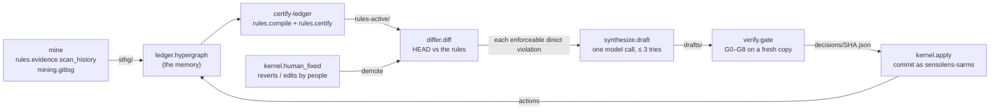

# sarms architecture — what each part does and how the parts connect

sarms is one Python package (`src/sarms`) plus scripts (`tools/`) that drive it. Inside the package, every
subpackage sits on a layer and may import only the layers below it. `.importlinter` enforces this, so the
map below stays true: `uv run lint-imports` fails the moment an import breaks it.

## The layers

```mermaid
flowchart TB
    cli["cli · __main__<br/>sarms COMMAND"]
    subgraph research["research (the product never imports these)"]
        baseline["baseline<br/>Step 1c proxy run + awareness-gap report"]
        trackc["trackc<br/>co-change, hypergraph network, belief"]
    end
    product["product<br/>mine → certify-ledger → run · status · clean"]
    kernel["kernel<br/>commit an accepted fix"]
    subgraph loop["the repair step"]
        synthesize["synthesize<br/>drafts (the only model user) · rule adoption"]
        verify["verify<br/>gate G0–G8"]
    end
    differ["differ<br/>the Monitor: four labels"]
    rules["rules<br/>compiled · learned · certified"]
    subgraph data["reading the repository and remembering it"]
        mining["mining<br/>history, change stream, ADRs"]
        graph["graph<br/>import graph of a commit"]
        ledger["ledger<br/>STHG ledger, spec ledger, episodes"]
    end
    core["core<br/>paths · git · import-linter records · lint worker · pseudonyms"]

    cli -. "runs a module's main()" .-> product
    cli -.-> rules & differ & ledger & synthesize
    product --> kernel & synthesize & verify & differ & rules & ledger & mining & core
    kernel --> verify
    synthesize --> differ & rules
    verify --> differ & rules
    differ --> rules
    rules --> ledger
    trackc --> rules
    baseline --> ledger
    kernel & synthesize & verify & differ & rules & baseline --> core
    mining & graph & ledger --> core
```

Solid arrows are real imports (computed with grimp, the library import-linter uses). Dotted arrows are the
command table in `cli.py`, which imports a module only when its command runs. Two contracts guard the
layering:

1. **Layers.** `__main__` → `cli` → `baseline | trackc` → `product` → `kernel` → `synthesize | verify` → `differ` → `rules`
   → `graph | ledger | mining` → `core`. A `|` marks siblings that may not import each other.
2. **No model in the checks.** `differ`, `verify` and `kernel` never import `synthesize`, the only package
   that talks to a language model, not even indirectly.

## The product loop (`sarms run`), and what each step leaves under `data/<repo>/rms/`



Everything else is recorded in the ledger and `run.json`, never fixed by hand. People read the ledger
afterwards (`sarms status`).

## Every module

| Package | Module | What it does |
| --- | --- | --- |
| *(top)* | `cli.py` | The command table: `sarms <command>` → the module whose `main()` runs it. |
| | `__main__.py` | `python -m sarms` runs the same command line. |
| | `product.py` | The whole workflow on one repository: `mine`, `certify_ledger`, `run`, `status`, `clean`. |
| `core` | `paths.py` | Where things live: `data/`, `data/raw/`, `reports/`, `docs/spec/`; repository names; worktree and output paths. |
| | `git.py` | git as a subprocess: partial clones, refs, the first-parent chain, file contents at a commit, patch fingerprints. |
| | `contracts.py` | import-linter records: find the config at a commit, read it with import-linter's readers, normalise contracts (strict record, optional layers); module patterns. |
| | `tree.py` | Checked-out trees, where each root package lives, and running the lint worker. |
| | `_lint_worker.py` | The subprocess that checks contracts on one tree (a fresh process per commit, so no import state leaks). |
| | `privacy.py` | Salted pseudonyms for authors (`docs/ethics.md`). |
| `mining` | `first_parent.py` | Step 1b: one row per first-parent commit → `commits.parquet`. |
| | `gitlog.py` | The change stream: one row per (commit, source file) with churn, noise (docs, tests, vendored, lock files) removed. |
| | `adr_history.py` | ADRs at HEAD, dated by the commit that added them, with title, status and a structural-rule flag. |
| `graph` | `extract.py` | The module import graph of one commit (grimp) → edges, modules, packages, `summary.json`. |
| `ledger` | `hypergraph.py` | The STHG ledger: commits as hyperedges over components and files, graph snapshots and deltas, labels, actions, certificates (DuckDB + parquet). |
| | `build.py` | The spec ledger (`docs/spec/ledger.sql`) from the Differ's replay or the Step 1c output; the awareness-gap view. |
| | `episodes.py` | The life of one violating edge: introduced, repaired, gap. Shared by the ledger and the baseline. |
| `rules` | `compile.py` | Written import-linter contracts → the rule bundle (schema-checked YAML + `contracts.json`); `load_rules`, `load_bundle`. |
| | `record_history.py` | Step 1c: the HEAD record frozen, and every change to it over the history. |
| | `evidence.py` | The rule learner: the component graph over sampled history → candidate rules. Never reads the written record. |
| | `viability.py` | Scores a learned rule on its own merits (loose tiers, strict gates). |
| | `certify.py` | The six-axiom specification A1–A6, a certificate per rule, an independent checker; adoption from the ledger. |
| `differ` | `diff.py` | The Differ: one commit against the rules → ADDITIONAL / INVERTED / MISSING / CONFIRMED, drift indicators, SARIF. |
| | `replay.py` | The Differ over a first-parent chain → the parquet files the ledger loads. |
| `synthesize` | `draft.py` | One violation → one drafted fix, tried in a copy: FIND/REPLACE blocks, static checks, retries with the reason; the template drafter. |
| | `prompt.py` | What the model is told; our code chooses every line of it. |
| | `llm.py` | The only model client: any OpenAI-compatible endpoint (Ollama, Gemini, …) or `fake:` replies for tests. |
| | `adopt.py` | Autonomous rule adoption: learned candidates → soft rules, with an optional model judge (`sarms adopt`). |
| `verify` | `gate.py` | Gate G0–G8 on a fresh copy of the author's commit → a signed decision record (accept or escalate). |
| `kernel` | `apply.py` | Applies an accepted, signed record as one `sensolens-sarms` commit, and reads what people did to it afterwards. |
| `baseline` | `proxy_lint.py` | Step 1c: the frozen HEAD record applied to sampled commits under the strict record. |
| | `report.py` | Step 1c: the awareness-gap baseline and criterion 4 → `reports/awareness-gap-baseline*.md`. |
| `trackc` | `cochange.py` | Directional co-change confidence, layer-violation candidates, file hotspots. |
| | `hgnn.py` | A hypergraph neural network over the change stream (needs torch: `uv sync --group hgnn`). |
| | `belief.py` | Dempster–Shafer belief functions: enforce, monitor or drop a rule, with feedback from outcomes. |

## Around the package

| Folder | What is there | How it connects |
| --- | --- | --- |
| `tools/` | Scripts for repository selection, the Step 1 pipeline, evaluation harnesses, studies, figures and the spec ([index](../tools/README.md)). | Import `sarms` like any user; some call each other by path. Never imported by the package. |
| `tests/unit/` | Single modules on in-memory or synthetic data; no git repository needed. | `uv run pytest -q tests/unit` (about a minute). |
| `tests/integration/` | End to end on a tiny subject repository driven through real git (`subject_repo.py`). | Covers compile → Differ → ledger → draft → gate → kernel → product. |
| `docs/spec/` | The frozen specification: vocabulary, rule schema, ledger DDL, gate, decision record, protocols. | Read at run time by `rules.compile` (schema) and `ledger.build` (DDL); checked by `tools/validate_spec.py`. Changed only by dated amendments. |
| `docs/` | Product overview, runbook, build plan, research notes. | `docs/runbook-commands.md` has every command. |
| `data/` | `raw/` clones and `<repo>/rms/` outputs (git-ignored); `samples/` labelling sheets and small example outputs (tracked). | Written by the product and the tools; paths come from `sarms.core.paths`. |
| `reports/` | Generated reports. | Written by `tools/` and `sarms.baseline.report`. |
